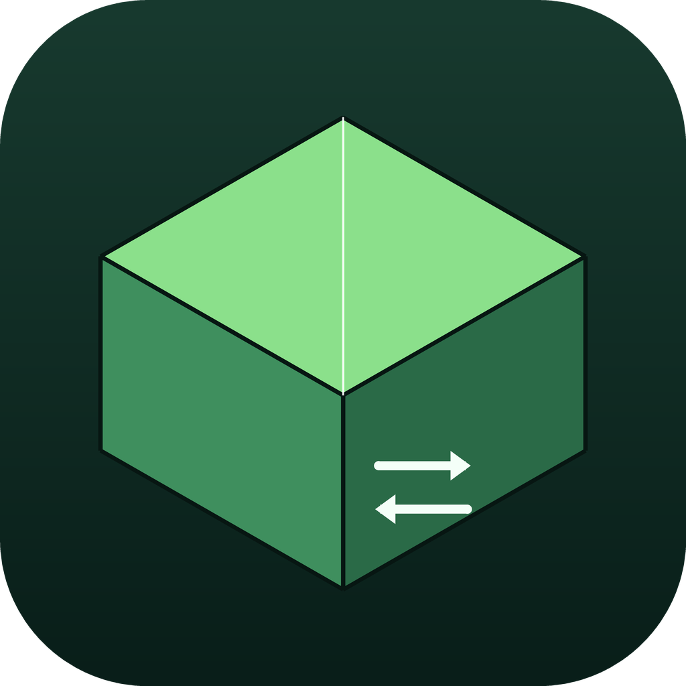
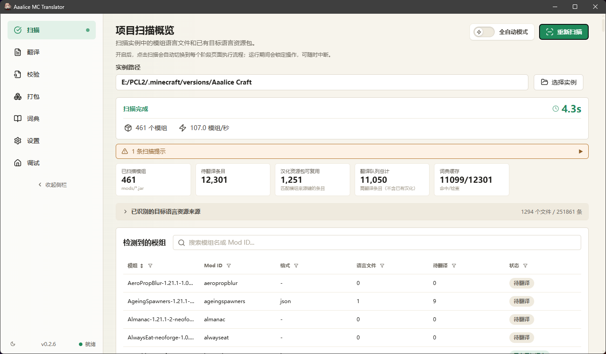
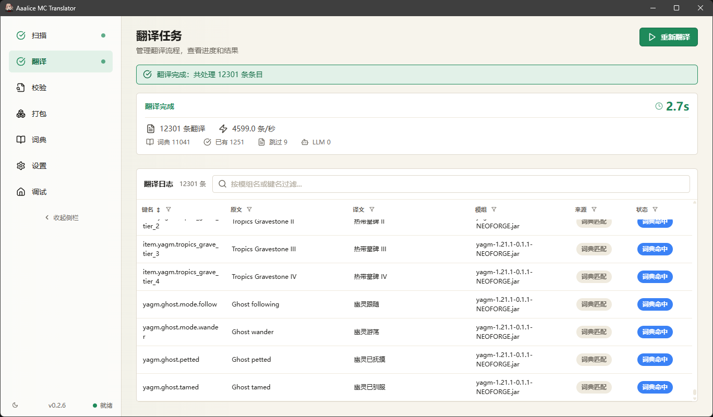
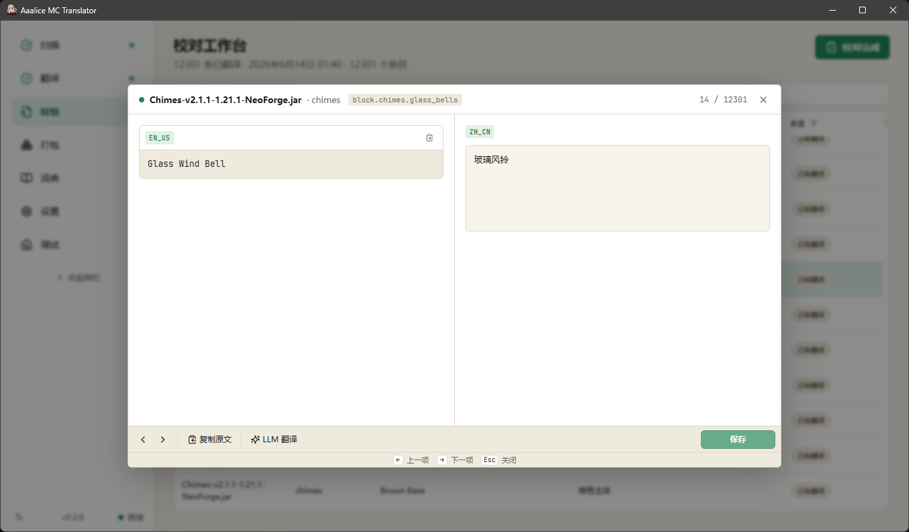
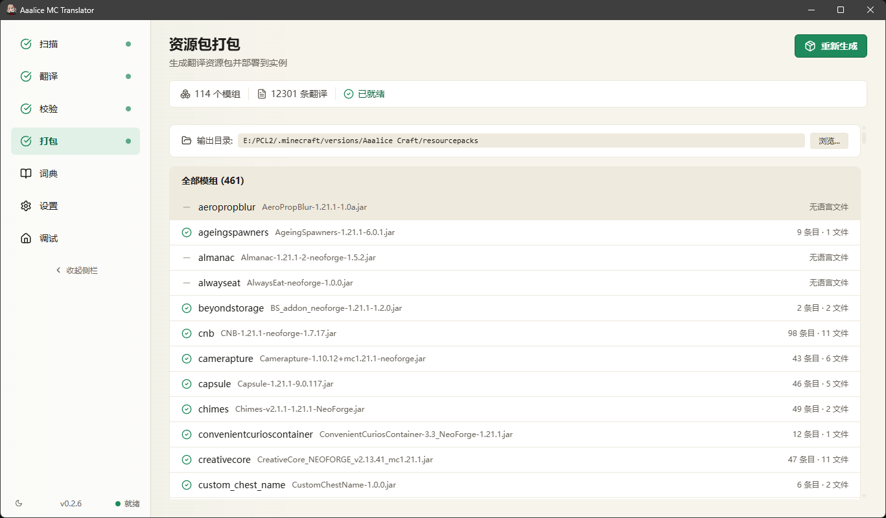
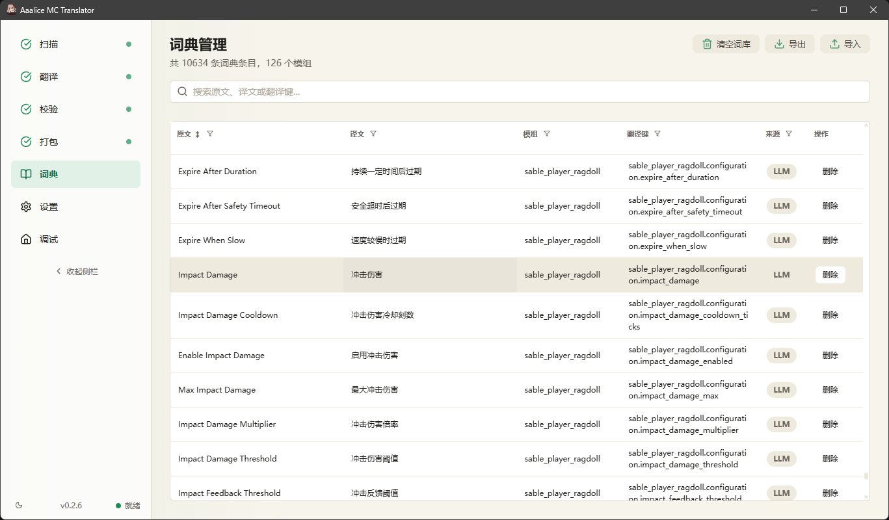
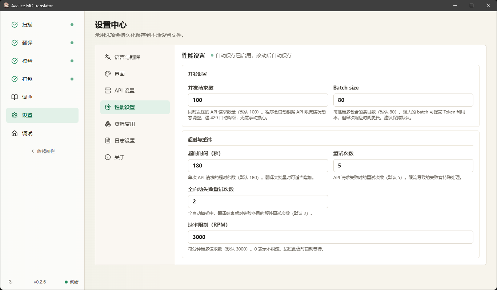
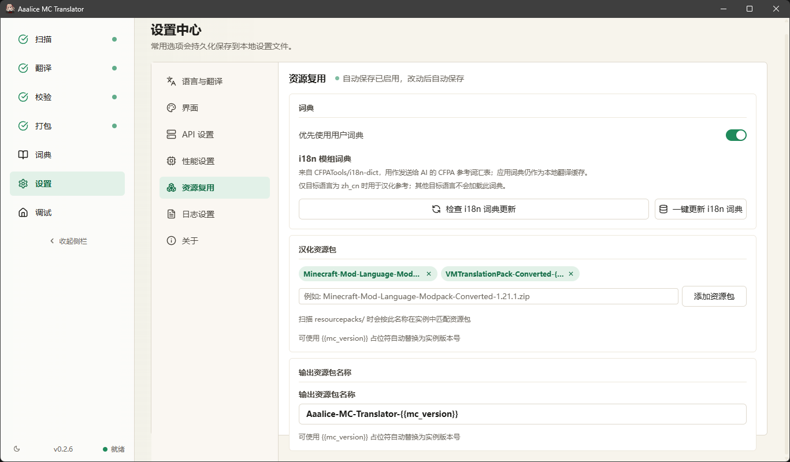

# CraftLingo (方块译匠)

> A Windows desktop tool for localizing Minecraft modpacks, forked from Aaalice's [MC Translator](https://github.com/Aaalice233/Aaalice_Minecraft_Translator) (MIT) and released under **AGPL-3.0**. It scans mod language files, reuses existing translations, fills the remaining gaps with an LLM, and exports a ready-to-use resource pack.

<p align="center">
  
</p>

<p align="center">
  <a href="README.md">简体中文</a> · <b>English</b>
</p>

---

## Project Focus

CraftLingo is built for localizing large Minecraft modpacks. It scans mod language resources, reuses existing resource packs, the local dictionary, and the i18n reference dictionary, then sends the remaining gaps to an LLM. The final output is a standard Minecraft resource pack, so original mod JARs stay untouched.

It is useful when:

- A modpack contains many mods, and manually finding language files or missing entries is too expensive.
- You already have partial localization resources and want to reuse them before translating the gaps.
- You need to maintain translation cache, review edits, and reuse previous work across repeated scans.
- You need to control LLM concurrency, batch size, RPM, timeout, and retries for large translation jobs.

## Core Features

- **Instance scanning and entry counts**: scan instance folders and mod JARs in parallel, extract `.json` / `.lang` language files, and summarize translatable entries, existing resource-pack hits, and remaining gaps.
- **Translation concurrency pool**: maintain the LLM request pool through concurrency, `Batch size`, timeout, retry count, and RPM limits across DeepSeek, OpenAI, or OpenAI-compatible APIs.
- **Local translation cache**: reuse previous translations from the local dictionary first; new translation results are written back so later scans and translation jobs can use them.
- **Dictionary maintenance**: search, edit, delete, import, export, and clear entries for mod terminology, review edits, and cached translations.
- **Model and prompt configuration**: configure model, request parameters, and role prompts for item names, block names, quest text, and other Minecraft-specific translation cases.
- **i18n reference dictionary**: pulled from the [CraftLingo-Dictionary](https://github.com/xiaotang666/CraftLingo-Dictionary) repository (a VM-enhanced dictionary where VM entries override the project's own library) and used as a `zh_cn` reference. The client checks on startup and can update manually from Settings.
- **Auto localize**: generates `zh_cn` language files for an instance from the dictionary only, without calling an LLM. Unmatched entries can be exported to JSON, translated externally, and imported back in place; importing never modifies the dictionary.
- **Placeholder and format protection**: preserve Minecraft formatting codes, variables, `String.format` placeholders, `{player}`, `{{...}}`, `<item:...>`, and similar runtime-sensitive fragments before and after translation.
- **Translation result validation**: check missing translations, missing placeholders, and format issues; failed entries stay in the failure queue for retry or manual handling.
- **Review and single-entry retranslation**: review source and translated text entry by entry, save manual edits, and rerun the LLM for a single entry when needed.
- **Task cancellation and resume**: scanning and translation tasks can be cancelled; translation progress and result files are persisted so later runs can reuse existing results.
- **Resource-pack generation and updates**: generate a standard resource pack zip with `pack.mcmeta` based on the Minecraft version; output names are fixed or configurable, and copying to an instance updates the existing pack with the same name.
- **Logs and error diagnostics**: keep main logs, job logs, and error details for troubleshooting; debug logging is controlled by settings.
- **Automatic workflow**: fully automatic mode chains scanning, translation, validation, and packaging while preserving progress, logs, and failed-entry retry points.
- **Theme and UI preferences**: switch between light and dark themes, with the preference saved to local settings.

## Screenshots

<table>
  <tr>
    <td width="50%">
      
      <br />
      <sub>Scan overview: summarizes mods, language resources, pending entries, and dictionary-cache hits.</sub>
    </td>
    <td width="50%">
      
      <br />
      <sub>Translation jobs: track throughput, dictionary hits, existing translations, skipped entries, and LLM results.</sub>
    </td>
  </tr>
  <tr>
    <td width="50%">
      
      <br />
      <sub>Review workspace: compare source and translated text, copy source, retranslate with LLM, and save manual edits.</sub>
    </td>
    <td width="50%">
      
      <br />
      <sub>Packaging: group output by mod and generate a resource pack that can be placed in <code>resourcepacks/</code>.</sub>
    </td>
  </tr>
  <tr>
    <td width="50%">
      
      <br />
      <sub>Dictionary management: search, edit, delete, import, and export translation cache for long-term terminology maintenance.</sub>
    </td>
    <td width="50%">
      
      <br />
      <sub>Performance settings: tune the translation concurrency pool, batch size, timeout, retries, and rate limits.</sub>
    </td>
  </tr>
  <tr>
    <td colspan="2">
      
      <br />
      <sub>Resource reuse: manage the i18n reference dictionary, existing localization resource packs, and output resource-pack naming.</sub>
    </td>
  </tr>
</table>

## Quick Start

### Requirements

- Windows 10 / Windows 11 64-bit
- A standard Minecraft instance directory, such as PCL2, HMCL, or the official launcher
- An available LLM API key

### Install

Download the latest version from [Releases](https://github.com/xiaotang666/CraftLingo/releases).

- Installer: recommended for most users. It supports a custom install directory, Start menu/shortcut integration, and in-app automatic updates.
- Portable exe: no installation required. Use it for temporary runs or USB drives; updates must be downloaded manually.

The app supports automatic updates from `Settings -> About & Updates`.

### Workflow

```text
Select MC instance -> Scan mods -> Configure LLM API -> Translate -> Review -> Package
```

The generated resource pack can be copied into the instance `resourcepacks/` directory.

When fully automatic mode is enabled, the app chains scanning, translation, validation, and packaging with the current settings. If a stage fails, the real error, logs, and current progress are preserved for debugging.

## Development

### Requirements

- Node.js 20+
- npm 10+
- Rust stable

### Commands

| Task | Command |
| --- | --- |
| Start frontend dev server | `npm run dev` |
| Start Tauri dev mode | `npm run tauri dev` |
| Build frontend | `npm run build` |
| Run frontend tests | `npm run test:unit` |
| Run Rust tests | `npm run test:rust` |
| Build NSIS installer | `npm run package:exe` |
| Build portable exe | `npm run package:app` |

## Project Structure

```text
CraftLingo/
├── assets/                  App icons and resource-pack icon
├── data/                    Local runtime data, ignored by .gitignore
├── docs/                    Product, architecture, UI, and test docs
├── logs/                    Runtime logs, ignored by .gitignore
├── scripts/                 Packaging and helper scripts
├── src/                     React + TypeScript frontend
│   ├── api/                 Tauri API wrapper and browser mocks
│   ├── app/                 App shell, Context, and global state sync
│   ├── components/          Shared UI components
│   ├── hooks/               Shared React hooks
│   ├── i18n/                UI translation dictionary
│   ├── pages/               Feature pages
│   ├── stores/              Zustand stores
│   └── styles/              Global styles
├── src-tauri/               Tauri 2 + Rust backend
│   ├── src/commands/        Tauri commands
│   ├── src/core/            Scanner, dictionary, LLM, packer, logs, and core logic
│   └── tauri.conf.json      Window, bundling, and updater config
├── tests/                   Vitest tests and fixtures
├── CHANGELOG.md             Changelog
├── LICENSE                  AGPL-3.0 license
├── NOTICE                   Copyright and third-party notices
├── README.en-US.md          English README
└── README.md                Chinese README
```

## Tech Stack

### Frontend

- React 18
- TypeScript 5
- Vite 6
- Zustand
- react-virtuoso
- lucide-react
- Vitest + Testing Library

### Backend

- Tauri 2
- Rust 2021
- Rayon
- reqwest
- rusqlite
- serde / serde_json
- zip
- tracing

## Project Rules

- Do not modify original mod JARs.
- Do not replace existing user resource packs without confirmation.
- Resource-pack output uses `assets/<modid>/lang/<targetLanguage>.json`.
- Frontend and backend models are synchronized through camelCase JSON. Update both `src/types.ts` and `src-tauri/src/core/models.rs` when changing shared data structures.
- New UI text must be added to `src/i18n/translations.ts`.

## Documentation

See [docs/00-index.md](docs/00-index.md) for the full documentation index.

## References

- [MineAI-Modpack-Translator](https://github.com/Thedrezik/MineAI-Modpack-Translator)
- [mc-autotranslator](https://gitee.com/li27744/mc-autotranslator)

## Acknowledgements

- The i18n dictionary is no longer bundled; it is downloaded from the [CraftLingo-Dictionary](https://github.com/xiaotang666/CraftLingo-Dictionary) repository, which merges the project's own library with [CFPATools/i18n-dict](https://github.com/CFPATools/i18n-dict) and [VM-Chinese-translate-group/i18n-Dict-Extender](https://github.com/VM-Chinese-translate-group/i18n-Dict-Extender). Dictionary data is distributed under CC BY-NC-SA 4.0.
- Thanks to the [LINUX DO](https://linux.do/) community for supporting open-source project sharing and discussion.

## License

This project is licensed under the [GNU Affero General Public License v3.0 or later](LICENSE) (AGPL-3.0-or-later).

You are free to use, modify, and distribute it, but **if you run a modified version as a network service, you must release its source code**. See [LICENSE](LICENSE) for the full terms.

This project is derived from Aaalice's [MC Translator](https://github.com/Aaalice233/Aaalice_Minecraft_Translator) (MIT). The original MIT notice is retained in [NOTICE](NOTICE); the MIT-covered portions remain available under the MIT License.
